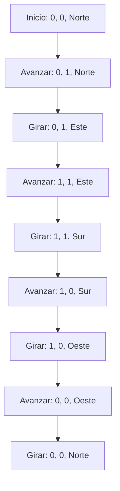
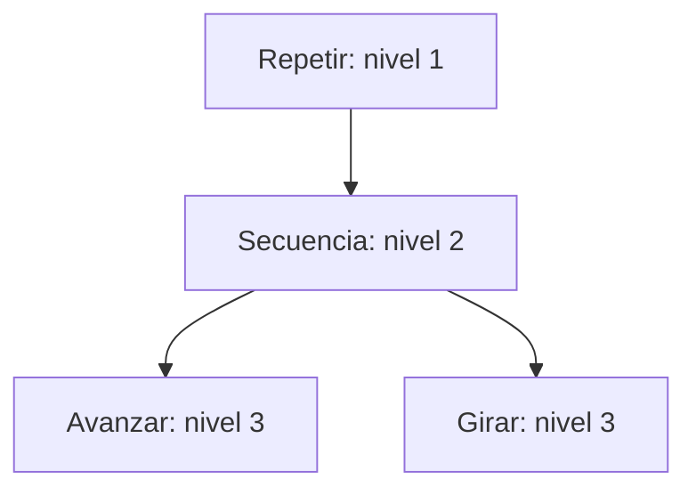
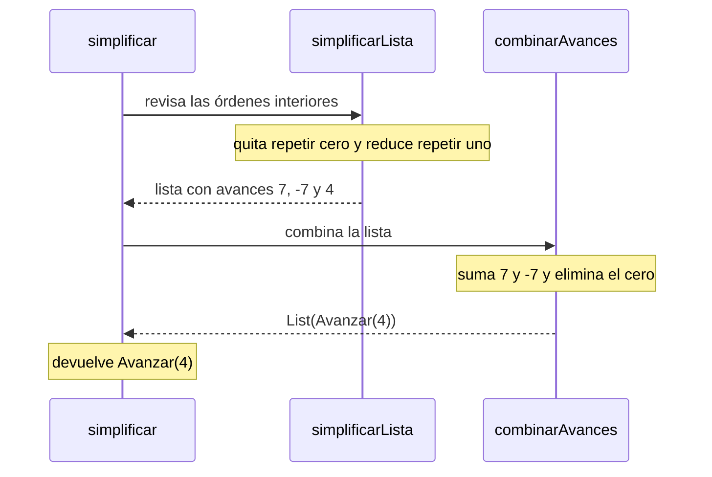

El robot comienza en `Estado(0, 0, Norte)`. Las coordenadas indican
dónde está y el tercer dato señala hacia dónde mira.

Las órdenes pueden contener otras órdenes. Por eso algunas funciones
deben entrar en su contenido y continuar hasta encontrar avances,
giros o listas vacías.

## 1. Cambiar la dirección con `girar`

### Definición

```scala
def girar(d: Direccion, s: Sentido): Direccion = (d, s) match {
  case (Norte, Derecha) => Este
  case (Este, Derecha) => Sur
  case (Sur, Derecha) => Oeste
  case (Oeste, Derecha) => Norte
  case (Norte, Izquierda) => Oeste
  case (Oeste, Izquierda) => Sur
  case (Sur, Izquierda) => Este
  case (Este, Izquierda) => Norte
}
```

`d` es la dirección actual y `s` es el sentido del giro.
`match` compara esa pareja con los casos escritos y devuelve
la dirección que corresponde.

### Paso a paso

Para:

```scala
girar(Este, Izquierda)
```

se tiene:

```text
d = Este
s = Izquierda
(d, s) = (Este, Izquierda)
Coincide con case (Este, Izquierda) => Norte
Devuelve Norte
```

No hay una llamada recursiva. Se encuentra el caso y termina.

### Estado del robot

Si está en `Estado(3, 2, Este)`, ejecutar ese giro lo deja en:

```scala
Estado(3, 2, Norte)
```

Las coordenadas siguen iguales. `girar` calcula la dirección;
`ejecutar` utiliza esa respuesta para formar el nuevo estado.

## 2. Ejecutar las órdenes

### Funcionamiento

`ejecutar` recibe un estado y una orden. Revisa cuatro posibilidades:

- `Avanzar(n)`: cambia una coordenada según la dirección.
- `Girar(sentido)`: conserva la posición y cambia hacia dónde mira.
- `Repetir(veces, orden)`: ejecuta el contenido y continúa con una
  repetición menos.
- `Secuencia(ordenes)`: recorre la lista con la auxiliar `aux`.

Una repetición de cero o menos veces devuelve el estado recibido.

### Avance con un número negativo

Por ejemplo:

```scala
ejecutar(Estado(2, 5, Oeste), Avanzar(-3))
```

El caso oeste calcula `e.x - n`:

```text
x = 2 - (-3) = 5
y = 5
Resultado: Estado(5, 5, Oeste)
```

El robot retrocede porque el número de pasos es negativo.

### Recorrido de una lista

Dentro del caso `Secuencia` se define:

```scala
@tailrec
def aux(estado: Estado, pendientes: List[Orden]): Estado =
  pendientes match {
    case Nil => estado
    case cabeza :: cola => aux(ejecutar(estado, cabeza), cola)
  }
```

`cabeza` es la primera orden y `cola` contiene las demás.

Primero termina `ejecutar(estado, cabeza)`. Después, el estado
obtenido pasa a la siguiente llamada de `aux`.

Cuando los pendientes son `Nil`, se devuelve la respuesta.

Por ejemplo:

```text
aux(Estado(0, 0, Norte), List(Avanzar(2), Girar(Derecha)))
→ aux(Estado(0, 2, Norte), List(Girar(Derecha)))
→ aux(Estado(0, 2, Este), Nil)
→ Estado(0, 2, Este)
```

`@tailrec` comprueba que la llamada recursiva de esta auxiliar
pueda realizarse sin acumular llamadas de `aux` esperando un resultado.

Las órdenes interiores todavía pueden requerir otras llamadas
a `ejecutar`.

### Recorrido del cuadrado

Usamos la orden del taller:

```scala
val cuadrado =
  Repetir(4, Secuencia(List(Avanzar(1), Girar(Derecha))))
```

En la tabla, `A` representa `Avanzar(1)` y `G` representa
`Girar(Derecha)`. Los pendientes muestran las acciones básicas
que faltan en su orden de ejecución.

| Paso | Acción realizada | Estado | Pendientes |
|---|---|---|---|
| 0 | Inicio | `Estado(0, 0, Norte)` | A, G, A, G, A, G, A, G |
| 1 | A | `Estado(0, 1, Norte)` | G, A, G, A, G, A, G |
| 2 | G | `Estado(0, 1, Este)` | A, G, A, G, A, G |
| 3 | A | `Estado(1, 1, Este)` | G, A, G, A, G |
| 4 | G | `Estado(1, 1, Sur)` | A, G, A, G |
| 5 | A | `Estado(1, 0, Sur)` | G, A, G |
| 6 | G | `Estado(1, 0, Oeste)` | A, G |
| 7 | A | `Estado(0, 0, Oeste)` | G |
| 8 | G | `Estado(0, 0, Norte)` | Ninguna |

Al terminar cada vuelta de avance y giro, la repetición continúa así:

```text
ejecutar(Estado(0, 0, Norte), Repetir(4, ...))
→ ejecutar(Estado(0, 1, Este), Repetir(3, ...))
→ ejecutar(Estado(1, 1, Sur), Repetir(2, ...))
→ ejecutar(Estado(1, 0, Oeste), Repetir(1, ...))
→ ejecutar(Estado(0, 0, Norte), Repetir(0, ...))
→ Estado(0, 0, Norte)
```

### Diagrama del recorrido



El robot vuelve al origen mirando al norte.

## 3. Contar acciones y medir los niveles

### `cuantasBasicas`

Un avance o un giro cuenta como una orden básica.

En una repetición positiva se multiplica el conteo del contenido
por las veces. Para cero o negativos se devuelve cero.

Una secuencia vacía vale cero. Si tiene elementos, se suma el
resultado de `cabeza` con el de `cola`.

Para el cuadrado:

```text
cuantasBasicas(cuadrado)
→ 4 * cuantasBasicas(Secuencia(List(Avanzar(1), Girar(Derecha))))
→ 4 * (1 + cuantasBasicas(Secuencia(List(Girar(Derecha)))))
→ 4 * (1 + 1 + cuantasBasicas(Secuencia(Nil)))
→ 4 * (1 + 1 + 0)
→ 8
```

Las sumas esperan a que termine el conteo del resto.
La multiplicación se resuelve al recibir el resultado interior.

`Avanzar(0)` también cuenta como una instrucción, aunque no mueva
al robot.

### `profundidad`

Esta función cuenta niveles de órdenes dentro de otras.

Una básica tiene profundidad uno. `Repetir` agrega un nivel al
de su contenido. Una secuencia vacía también tiene valor uno.

Para una lista no vacía se calculan:

```scala
val profundidadCabeza = profundidad(cabeza) + 1
val profundidadCola = profundidad(Secuencia(cola))
```

La cabeza necesita sumar el nivel de la secuencia que la contiene.
La llamada sobre la cola ya incluye ese nivel.

El `if` compara ambos valores y devuelve el mayor.

Para el cuadrado:

```text
profundidad(Secuencia(Nil)) = 1

profundidad(Secuencia(List(Girar(Derecha))))
→ comparar 2 con 1
→ 2

profundidad(Secuencia(List(Avanzar(1), Girar(Derecha))))
→ comparar 2 con 2
→ 2

profundidad(cuadrado)
→ 1 + 2
→ 3
```

### Diagrama de niveles



Las cantidades de repeticiones afectan el conteo de acciones,
pero no los niveles.

Estas consultas no ejecutan movimientos. El robot conserva
su posición y dirección mientras se calculan los números.

## 4. Construir y transformar rutinas

### `componer`

La función pone las dos órdenes recibidas en una secuencia:

```scala
def componer(o1: Orden, o2: Orden): Orden =
  Secuencia(List(o1, o2))
```

Por ejemplo:

```scala
componer(Avanzar(3), Girar(Izquierda))
```

produce:

```scala
Secuencia(List(Avanzar(3), Girar(Izquierda)))
```

Al ejecutarla desde el origen:

```text
Estado(0, 0, Norte)
→ Estado(0, 3, Norte)
→ Estado(0, 3, Oeste)
```

Construir la orden no mueve al robot. El recorrido comienza
cuando se llama a `ejecutar`.

### `rutina`

Su definición es:

```scala
def rutina(pasos: Int)(giro: Sentido)(veces: Int): Orden =
  Repetir(veces, componer(Avanzar(pasos), Girar(giro)))
```

Los argumentos llegan en tres grupos. Esto permite fijar los pasos
y el giro antes de indicar las repeticiones:

```scala
val recorrido: Int => Orden = rutina(2)(Izquierda)
val orden = recorrido(2)
```

La orden obtenida es:

```scala
Repetir(2, Secuencia(List(Avanzar(2), Girar(Izquierda))))
```

Desde el estado inicial:

```text
Estado(0, 0, Norte)
→ Estado(0, 2, Norte)
→ Estado(0, 2, Oeste)
→ Estado(-2, 2, Oeste)
→ Estado(-2, 2, Sur)
```

### `aplicarA`

Si la lista está vacía, devuelve `Nil`.

En otro caso ejecuta la orden sobre el primer estado y continúa
con los restantes:

```scala
case cabeza :: cola => ejecutar(cabeza, o) :: aplicarA(cola, o)
```

Para:

```scala
aplicarA(
  List(Estado(1, 2, Este), Estado(-2, 4, Sur)),
  Avanzar(3)
)
```

las ejecuciones son:

```text
Estado(1, 2, Este) → Estado(4, 2, Este)
Estado(-2, 4, Sur) → Estado(-2, 1, Sur)
```

Al unir las respuestas se obtiene:

```scala
List(Estado(4, 2, Este), Estado(-2, 1, Sur))
```

Cada robot parte desde su propio estado. La construcción de la lista
queda pendiente mientras se procesa la cola.

### `transformar`

Los avances y giros se reemplazan por el resultado de `f(o)`.

Las repeticiones conservan sus veces y transforman el contenido.
En una secuencia, `map` aplica ese recorrido a cada elemento.

Por ejemplo:

```scala
val orden = Secuencia(List(Avanzar(3), Girar(Izquierda)))

transformar(orden, {
  case Avanzar(n) => Avanzar(2 * n)
  case otra => otra
})
```

El proceso es:

```text
Avanzar(3) → Avanzar(6)
Girar(Izquierda) → Girar(Izquierda)
```

La respuesta queda:

```scala
Secuencia(List(Avanzar(6), Girar(Izquierda)))
```

Desde el origen, la original termina en `Estado(0, 3, Oeste)`.
La transformada llega a `Estado(0, 6, Oeste)`.

Aquí el recorrido puede cambiar, según la función recibida.
Si `f` devuelve una orden compuesta, se toma ese resultado directamente;
no se vuelve a transformar lo que acaba de crear.

## 5. Reducir órdenes con `simplificar`

### Funcionamiento

Se busca una orden más corta que deje al robot en el mismo
estado final.

Los avances de cero y las repeticiones no positivas se convierten
en `Secuencia(Nil)`.

Una repetición de una vez devuelve su contenido simplificado.
Para las demás, primero se revisa el interior. Si queda vacío,
la repetición también desaparece.

Las secuencias utilizan dos auxiliares.

### `simplificarLista`

Recorre los elementos y simplifica cada cabeza.

Después revisa el resultado:

- Si es una secuencia vacía, lo retira.
- Si contiene una secuencia, incorpora sus órdenes en la misma lista.
- En otro caso, conserva la orden obtenida.

El símbolo `++` une dos listas respetando su orden.

### `combinarAvances`

Revisa la lista anterior:

- Un avance de cero se elimina.
- Dos avances seguidos se juntan sumando sus pasos.
- Cualquier otra orden se conserva antes de continuar.

Cuando suma dos avances, vuelve a revisar el resultado. Así puede
unir otro avance o quitar el cero que acaba de obtener.

### Ejemplo paso a paso

Tomamos:

```scala
Secuencia(List(
  Avanzar(7),
  Repetir(0, Girar(Derecha)),
  Avanzar(-7),
  Repetir(1, Avanzar(4))
))
```

Primero se revisa cada elemento:

```text
Avanzar(7) → Avanzar(7)
Repetir(0, Girar(Derecha)) → Secuencia(Nil)
Avanzar(-7) → Avanzar(-7)
Repetir(1, Avanzar(4)) → Avanzar(4)
```

`simplificarLista` quita el vacío y devuelve:

```scala
List(Avanzar(7), Avanzar(-7), Avanzar(4))
```

Después:

```text
combinarAvances(List(Avanzar(7), Avanzar(-7), Avanzar(4)))
→ combinarAvances(List(Avanzar(0), Avanzar(4)))
→ combinarAvances(List(Avanzar(4)))
→ List(Avanzar(4))
```

La revisión final encuentra una sola orden y devuelve:

```scala
Avanzar(4)
```

Este caso requiere varias reducciones. Quitar el vacío permite
juntar avances; su suma crea un cero que también debe eliminarse.

La versión escrita lo resuelve mediante las llamadas de ambas
auxiliares, sin reiniciar toda la función con una pasada general.

### Diagrama de llamadas



### Comparación de posiciones

| Paso de la original | Estado |
|---|---|
| Inicio | `Estado(0, 0, Norte)` |
| Avanzar 7 | `Estado(0, 7, Norte)` |
| Repetir cero veces | `Estado(0, 7, Norte)` |
| Avanzar -7 | `Estado(0, 0, Norte)` |
| Repetir una vez el avance de 4 | `Estado(0, 4, Norte)` |

La orden simplificada pasa directamente de `Estado(0, 0, Norte)`
a `Estado(0, 4, Norte)`.

Se conserva la posición y la dirección finales, aunque los pasos
intermedios sean distintos.